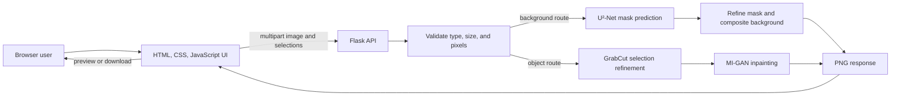

# Pixerase.AI

Pixerase.AI is an educational AI image-editing project for cleaning up pictures in a browser. It provides two workflows: remove an image background to make a transparent cutout or replacement scene, and mark unwanted objects for AI inpainting.

The application combines a Flask API with a vanilla HTML, CSS, and JavaScript interface. It is intended for students, developers, and computer-vision learners exploring image segmentation and inpainting.

> **Educational use only.** This statement describes the project's purpose; it does not replace or override the licenses and usage conditions of third-party code, model weights, datasets, or other materials. Review those terms before copying, redistributing, or using any part of this repository.

## Contents

- [Features](#features)
- [Screenshots](#screenshots)
- [Technology](#technology)
- [Architecture](#architecture)
- [Repository structure](#repository-structure)
- [Prerequisites](#prerequisites)
- [Model weights and downloads](#model-weights-and-downloads)
- [Local installation](#local-installation)
- [Using the application](#using-the-application)
- [Configuration](#configuration)
- [API overview](#api-overview)
- [Troubleshooting](#troubleshooting)
- [Limitations and future work](#limitations-and-future-work)
- [Contributing](#contributing)
- [License and educational use](#license-and-educational-use)
- [Acknowledgments and references](#acknowledgments-and-references)
- [Project link](#project-link)

## Features

- **Background removal:** predicts a foreground mask with U²-Net. The result can be a transparent PNG or composited over a supplied background image or the included template.
- **Object removal:** combines user selections with GrabCut mask refinement, then uses the 512-pixel Places2 MI-GAN checkpoint for inpainting. Rectangle selections and brush strokes can be combined; the eraser subtracts from the selection.
- **Image workflow:** upload JPG, PNG, or WebP; view the original and result; download the processed PNG; reset the current edit.
- **Editing controls:** object removal provides rectangle, brush, eraser, undo, and redo controls. Background removal provides a bundled template and custom-background upload.
- **Responsive interface:** pages adapt to narrow and wide screens, with light and dark themes and a saved theme preference.
- **Temporary request files:** the API writes request files into a temporary workspace and cleans it up after the response closes. The app does not implement accounts, an image gallery, or image history. This describes application behavior and is not a guarantee about host-level logs or storage.

The API defaults to a 25 MB upload limit and a 12-million-pixel decoded-image limit. The frontend and backend enforce their own input checks.

## Screenshots

No screenshots are currently included in the repository. Maintainers can add genuine captures under a `docs/screenshots/` directory and reference them here after adding the files.

## Technology

| Area | Technologies |
| --- | --- |
| Backend | Python 3.10, Flask, Flask-CORS, Gunicorn (configured for the existing service manifest) |
| Background segmentation | PyTorch, torchvision, U²-Net |
| Object inpainting | PyTorch, MI-GAN, OpenCV GrabCut |
| Image processing | Pillow, NumPy, OpenCV, SciPy |
| Frontend | HTML, CSS, browser JavaScript; no frontend build step or framework |
| Model distribution | Git LFS for the U²-Net `.pth` file; MI-GAN `.pt` checkpoint is tracked in Git |

The pinned PyTorch dependency is the CPU build. A GPU is not required by the documented setup.

## Architecture



For background removal, the backend validates the upload, resizes it to the model's 320 × 320 inference input, predicts a mask, refines the mask, and returns a transparent or composited PNG at the source image dimensions.

For object removal, the frontend sends the source image plus rectangle coordinates and/or brush and eraser masks. The backend combines the marked areas, refines them with GrabCut, runs MI-GAN at 512 × 512 inference resolution, then returns the processed PNG.

## Repository structure

```text
.
├── backend/
│   ├── app/
│   │   ├── routes/                 Flask page, health, and image API routes
│   │   ├── services/               Temporary files, model lifecycle, processing flow
│   │   ├── utils/                  Image validation
│   │   └── models/
│   │       ├── background/
│   │       │   ├── model/u2net.py  U²-Net implementation
│   │       │   └── models/u2net.pth U²-Net checkpoint (Git LFS)
│   │       └── object/
│   │           ├── infer.py       GrabCut and MI-GAN inference
│   │           ├── models/        MI-GAN checkpoint
│   │           ├── lib/, dnnlib/, torch_utils/  Vendored model implementation code
│   │           ├── configs/       Upstream model and experiment configs
│   │           ├── scripts/       Upstream demo, export, and research scripts
│   │           └── examples/      Sample images, masks, and outputs
│   ├── requirements.txt
│   ├── run.py                     Local Flask entry point
│   └── tests/                     API tests with mocked image processing
├── frontend/
│   ├── index.html                 Home page
│   ├── background.html            Background-removal page
│   ├── object.html                Object-removal page
│   ├── css/style.css              Shared responsive styling and themes
│   ├── js/                        Page logic, API calls, and theme behavior
│   └── assets/                    Favicon and background template
├── .env.example                  Example backend environment settings
├── .gitattributes                Git LFS rules for model file types
├── .gitignore                    Local and generated files to ignore
└── render.yaml                   Existing service configuration
```

`backend/app/models/object/main.py` and `scripts/` are retained upstream/research material; the Flask web app uses `infer.py` and the MI-GAN implementation modules. The sample images and configs are not needed for ordinary web inference, but are retained as provenance and reproducibility material.

## Prerequisites

- Python **3.10** (the dependency versions are pinned for this runtime).
- Git and Git LFS. Git LFS is needed to fetch `u2net.pth` when cloning the repository.
- A modern browser.
- Network access for installing Python packages on first setup.
- The U²-Net and MI-GAN weights described below.

CPU inference is supported by the pinned CPU-only PyTorch packages. The first request to each feature loads its model and can take time; inference is compute- and memory-intensive. No GPU is required.

## Model weights and downloads

The application expects these exact model paths relative to the repository root:

| Feature | Expected filename | Expected path | Current repository status |
| --- | --- | --- | --- |
| Background removal (U²-Net) | `u2net.pth` | `backend/app/models/background/models/u2net.pth` | Tracked with Git LFS (about 176.3 MB) |
| Object removal (MI-GAN Places2 512) | `migan_512_places2.pt` | `backend/app/models/object/models/migan_512_places2.pt` | Tracked directly in Git (about 29.6 MB) |

These files are already present in this repository checkout. Clone with Git LFS enabled and run `git lfs pull` if the U²-Net file is missing or appears as a small text pointer.

The following Google Drive links were supplied for the project. Their file-to-model mapping and access permissions have **not** been independently verified, so they are intentionally labeled by number. Check each downloaded file's name, contents, and compatibility before placing it; do not assume either link contains the expected checkpoint.

- [Model Download 1](https://drive.google.com/file/d/1CXz4uKQ7dEuupHYGsDvnixTRvleTaFfk/view?usp=drive_link)
- [Model Download 2](https://drive.google.com/file/d/1zf2lTlhITahfTRIn1VJ5RoFE-d-5fxQK/view?usp=drive_link)

If a required file is unavailable in a clone, first try `git lfs install` and `git lfs pull`. If you obtain a compatible checkpoint separately, place it at the exact path in the table. Do not rename a checkpoint unless the corresponding `BACKGROUND_MODEL_PATH` or `OBJECT_MODEL_PATH` setting is updated. The files from the two Drive links may not be the only assets needed by the retained upstream training or evaluation scripts; those scripts can require datasets, teacher checkpoints, and extra development packages. They are not required for the web app's inference workflow.

## Local installation

### 1. Clone the repository

Install Git LFS, initialize it, then clone:

```bash
git lfs install
git clone https://github.com/Samarth201104/Pixerase.AI.git
cd Pixerase.AI
git lfs pull
```

### 2. Create a virtual environment and install packages

**Windows PowerShell:**

```powershell
py -3.10 -m venv .venv
.\.venv\Scripts\Activate.ps1
python -m pip install --upgrade pip
python -m pip install -r backend/requirements.txt
```

If PowerShell blocks activation, use `.venv\Scripts\activate.bat` from Command Prompt, or run the venv's Python directly.

**Linux/macOS:**

```bash
python3.10 -m venv .venv
source .venv/bin/activate
python -m pip install --upgrade pip
python -m pip install -r backend/requirements.txt
```

### 3. Point the browser UI at the local API

For local development, edit `frontend/js/config.js` and set the API base URL to an empty string:

```js
window.APP_CONFIG = { apiBaseUrl: "" };
```

An empty base URL makes the browser send requests to the same Flask server that serves the pages. Restore your preferred API URL after local use if you have customized this file.

### 4. Start the application

From the repository root, activate `.venv` if it is not already active, then run:

```bash
cd backend
python run.py
```

Open [http://127.0.0.1:5000](http://127.0.0.1:5000). The Flask app serves the home page and the `/background` and `/object` pages itself; a separate frontend server is not needed.

## Using the application

### Background removal

1. Open [http://127.0.0.1:5000/background](http://127.0.0.1:5000/background).
2. Select an image or drag a JPG, PNG, or WebP file into the upload area.
3. Choose **Remove background** for a transparent PNG.
4. To use a new scene, select the included template or upload a custom background, then choose **Apply background**.
5. Review the result and choose **Download PNG**. Use **Reset** to start over.

### Object removal

1. Open [http://127.0.0.1:5000/object](http://127.0.0.1:5000/object) and upload an image.
2. Use **Rectangle** to mark an object area or **Brush** to paint over it. You can mark several objects and combine rectangles with brush strokes.
3. Use **Eraser** to remove parts of the selection. **Undo** and **Redo** adjust recent marks; **Reset** clears the edit.
4. Choose **Remove object**, wait for processing, review the output, and choose **Download PNG**.

## Configuration

The Flask app reads environment variables directly from the process environment. `.env.example` is a reference file; the application does not automatically load a `.env` file.

| Variable | Purpose | Default |
| --- | --- | --- |
| `FLASK_DEBUG` | Enable Flask debug mode | `false` |
| `MAX_UPLOAD_SIZE` | Maximum bytes per uploaded file | `26214400` (25 MiB) |
| `MAX_IMAGE_PIXELS` | Maximum decoded width × height | `12000000` |
| `CORS_ORIGINS` | Comma-separated origins allowed by Flask-CORS | `*` |
| `BACKGROUND_MODEL_PATH` | Override the U²-Net checkpoint path | `backend/app/models/background/models/u2net.pth` |
| `OBJECT_MODEL_PATH` | Override the MI-GAN checkpoint path | `backend/app/models/object/models/migan_512_places2.pt` |

Relative checkpoint overrides are resolved from the repository root; absolute paths are also accepted. Set environment variables in the shell before running `python run.py` if you need overrides. For example, in PowerShell:

```powershell
$env:MAX_IMAGE_PIXELS = "12000000"
```

## API overview

- `GET /api/health` returns a simple process health response.
- `POST /api/remove-background` accepts multipart form data with an `image` file and, optionally, a `background` file or `bg_template` value. It returns a PNG.
- `POST /api/remove-object` accepts an `image` plus selection data and returns a PNG. Rectangle selection uses `mode=rect`, `rects` (JSON coordinate list), `canvas_w`, and `canvas_h`. Brush selection uses `mode=brush` and `mask`; mixed selection uses `mode=mixed` and can include rectangles, `mask`, and `erase_mask`.

The object route accepts up to 20 rectangles. The frontend sends coordinates relative to the displayed canvas, and the backend scales them to the uploaded image dimensions.

## Troubleshooting

| Problem | What to check |
| --- | --- |
| `u2net.pth` is missing or too small | Run `git lfs install` and `git lfs pull`. Check that the file exists at `backend/app/models/background/models/u2net.pth` and is about 176 MB, not a short Git LFS pointer. |
| MI-GAN reports a missing model | Check `backend/app/models/object/models/migan_512_places2.pt` or the configured `OBJECT_MODEL_PATH`. The checkpoint must match the MI-GAN 512 Places2 model expected by `infer.py`. |
| `ModuleNotFoundError` during startup | Activate the project virtual environment and install `backend/requirements.txt` with Python 3.10. |
| PyTorch or torchvision install fails | Confirm Python is 3.10 and rerun `python -m pip install -r backend/requirements.txt`; the manifest pins CPU-compatible versions. |
| Browser reports it cannot connect to processing | For local use, set `apiBaseUrl` to an empty string in `frontend/js/config.js`, then access the pages from `http://127.0.0.1:5000` while `python run.py` is running. |
| Image is rejected | Use JPG, PNG, or WebP, keep the file under 25 MB, and keep its decoded dimensions at or below 12 million pixels unless you changed the backend limits. |
| Process exits or the machine runs out of memory | Model loading and inference need substantial memory. Try a smaller input or run on a machine with more available RAM; the application cannot guarantee inference on resource-constrained machines. |
| Drive link cannot be opened | The link owner must grant access. The repository's model paths and expected checkpoint names are listed in [Model weights and downloads](#model-weights-and-downloads); the supplied links have not been access-tested or mapped. |

## Limitations and future work

### Current limitations

- The pinned PyTorch build runs on CPU, so processing can be slow.
- U²-Net uses a fixed 320 × 320 model input; MI-GAN inpainting runs at a 512 × 512 model resolution. Fine details may be lost when an image is resized for inference.
- The object-removal route uses GrabCut to refine the user-marked selection before inpainting. Results depend on selection quality and image content.
- Model inference can exceed the memory available on small machines. A successful health response does not prove that image inference will fit.
- This repository has no root `LICENSE` file and therefore does not declare a blanket license for the project as a whole.

### Possible improvements

- Add verified screenshots and a short feature demo.
- Add reproducible model checksums and a verified mapping for the supplied download links.
- Add a documented license and attribution inventory after reviewing every vendored component and checkpoint.
- Add performance benchmarks across image sizes and supported hardware.

## Contributing

1. Fork the repository and create a focused branch, for example `fix/object-mask-validation`.
2. Keep changes scoped and preserve the existing HTML/CSS/JavaScript and Flask architecture.
3. Install the dependencies and run the API tests from `backend/`:

   ```bash
   python -m unittest discover -s tests -v
   ```

   These tests mock model processing and do not verify visual model quality or a full checkpoint inference.
4. Describe the behavior changed and the checks you ran in your pull request. Include screenshots for visible UI changes when available.

## License and educational use

Pixerase.AI is intended for **educational purposes only**. There is no root `LICENSE` file in this repository, so no project-wide license is declared here. Do not interpret this README's educational-purpose statement as permission to use, distribute, or commercialize code or model weights.

The upstream U-2-Net repository includes an Apache License 2.0 for its project; the licensing terms for the particular pretrained checkpoint bundled here should still be confirmed. The upstream MI-GAN repository identifies MIT licensing for its code and has a separate `LICENSE-WEIGHTS` file for its weights. However, this repository also vendors files containing NVIDIA copyright and license-agreement notices, and it does not include a documented agreement covering their redistribution. Review those notices and applicable upstream terms before reusing or redistributing the bundled MI-GAN source. This README is not legal advice.

## Acknowledgments and references

- **U²-Net:** Xuebin Qin, Zichen Zhang, Chenyang Huang, Masood Dehghan, Osmar R. Zaiane, and Martin Jagersand, [“U²-Net: Going Deeper with Nested U-Structure for Salient Object Detection”](https://arxiv.org/abs/2005.09007), Pattern Recognition 2020. [Official implementation and license](https://github.com/xuebinqin/U-2-Net).
- **MI-GAN:** Andranik Sargsyan, Shant Navasardyan, Xingqian Xu, and Humphrey Shi, [“MI-GAN: A Simple Baseline for Image Inpainting on Mobile Devices”](https://openaccess.thecvf.com/content/ICCV2023/html/Sargsyan_MI-GAN_A_Simple_Baseline_for_Image_Inpainting_on_Mobile_Devices_ICCV_2023_paper.html), ICCV 2023. [Official implementation](https://github.com/Picsart-AI-Research/MI-GAN), [code license](https://github.com/Picsart-AI-Research/MI-GAN/blob/main/LICENSE), and [weights license](https://github.com/Picsart-AI-Research/MI-GAN/blob/main/LICENSE-WEIGHTS).
- **OpenCV GrabCut:** used by the object-removal pipeline to refine marked regions before inpainting.

## Project link

[Pixerase.AI on GitHub](https://github.com/Samarth201104/Pixerase.AI)
